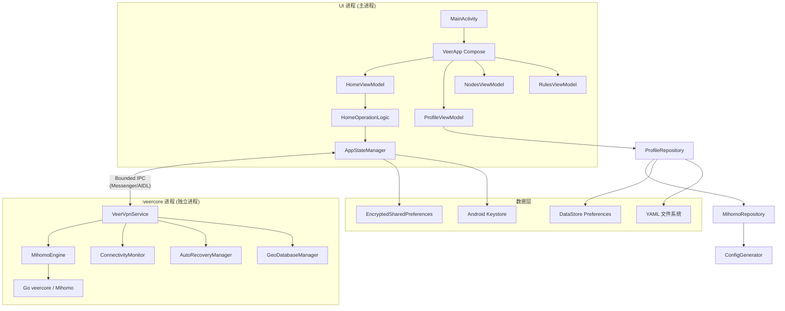
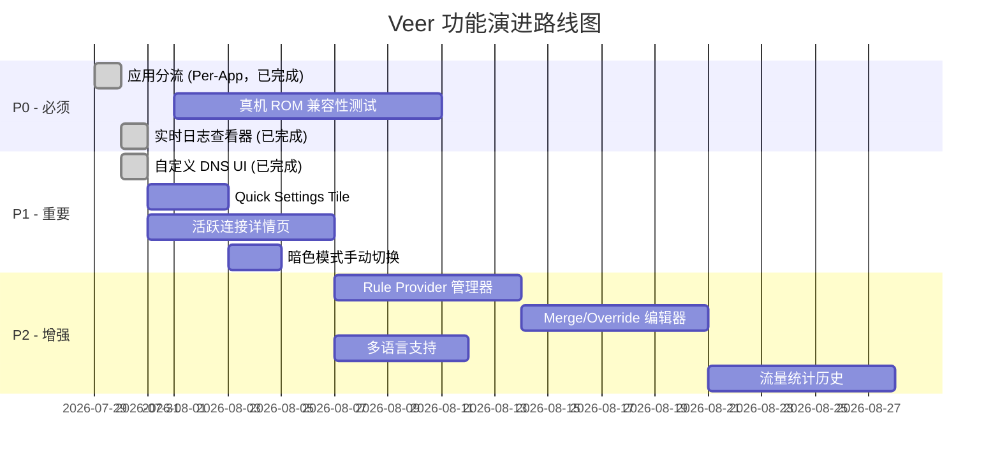

# Veer 项目完整解析报告

> 分析基于 2026-07-29 代码快照，覆盖全部源码、文档与工具链。

---

## 一、项目定位与技术栈

**Veer** (`com.yamax.veer`) 是一款 Android 原生 Mihomo (Clash Meta) VPN 客户端，核心差异化特性是 **AI 自然语言分流引擎**和**多进程隔离架构**。

| 维度 | 技术选型 |
|:--|:--|
| UI 框架 | Jetpack Compose + Material 3 |
| 语言 | Kotlin (Android 端) + Go (代理核心) |
| 代理内核 | Mihomo v1.19.29 (`cmfa,with_gvisor` 构建标签) |
| 跨语言桥接 | gomobile bind → `libveer_core.aar` (JNI) |
| 最低版本 | Android 10 (API 29) |
| 构建工具链 | JDK 21, Android NDK r27d, Gradle (Kotlin DSL) |

---

## 二、项目架构总览



### 2.1 多进程隔离架构

Veer 最突出的架构特点是将 VPN 服务运行在 **独立的 `:veercore` 进程**中：

- **UI 崩溃不影响代理隧道**：主进程闪退或重启，后台 VPN 通道不中断
- **跨进程状态同步**：通过 Messenger/Binder IPC 传递状态、流量计数、路由信息和日志
- **PID 监控与自愈**：UI 发现运行中的 core 进程意外退出时，自动触发一次安全重启
- **显式停止保护**：用户主动停止不会被误判为崩溃

### 2.2 Go 核心桥接层 (gomobile)

`go_core/` 通过 gomobile 向 Kotlin 导出完整 API：

| 导出函数 | 功能 |
|:--|:--|
| `SetProtector(SocketProtector)` | 注册 Android 套接字保护回调，防止路由环路 |
| `SetLogger(Logger)` / `DetachLogger()` | 连接/分离 Go → Logcat 日志桥 |
| `Start(homeDir, configPath, externalController)` | 启动 Mihomo 引擎 |
| `Stop()` | 安全停止引擎（含 provider/tracker/listener/TUN 清理） |
| `ValidateConfig(configPath)` | 启动前验证 YAML 合法性 |
| `QueryProxies()` | 查询全部节点和策略组（JSON 返回） |
| `SelectProxy(group, proxy)` | 切换 Selector 组的选中节点 |
| `HealthCheck(group)` | 对策略组发起延迟探测 |
| `ProbeDelay(proxyName, url, timeout)` | 单节点延迟测量 |
| `PatchRuleProviders()` | 热重载规则 Provider |
| `TrafficSnapshot()` | 获取实时上下行流量 |
| `ConnectionsSnapshot()` | 获取活跃连接列表 |

> **重要**：所有导出函数内部均包含 `defer recover()` 保护，Go panic 不会导致 Android 进程崩溃，而是转化为 Java Exception 返回。

---

## 三、源码模块详细解析

### 3.1 `core_mihomo/` — VPN 服务与引擎管理

这是整个项目最核心、代码量最大的模块。

| 文件 | 行数 | 功能 |
|:--|:--|:--|
| `VeerVpnService.kt` | ~1300+ | Android VpnService 实现；TUN fd 创建与移交、前台通知、序列化 start/stop、超时看门狗、生命周期状态机 |
| `MihomoRepository.kt` | ~700+ | Mihomo 控制器 HTTP API 交互：节点查询、延迟探测、Selector 切换、连接信息、规则重载 |
| `MihomoEngine.kt` | ~100 | Go veercore JNI 调用的 Kotlin 封装 |
| `ConnectivityMonitor.kt` | ~180 | 网络状态变更监听（Wi-Fi ↔ 移动数据 ↔ 断网），识别切换类型 |
| `ConnectivityTransitionClassifier.kt` | ~200 | 网络切换事件的分类决策引擎 |
| `AutoRecoveryManager.kt` | ~180 | 节点故障自动恢复：有界候选探测、最后健康节点偏好、Selector 还原 |
| `GeoDatabaseManager.kt` | ~230 | GeoIP / GeoSite 数据库校验与更新 |
| `VpnRoutePolicy.kt` | ~90 | LAN 绕过路由策略（IPv4 RFC1918 + IPv6 ULA/link-local，API 33+/29+ 双路径） |
| `ipc/` | — | 跨进程 IPC 消息定义与 Messenger 封装 |

### 3.2 `core_profile/` — 配置与订阅管理

| 功能 | 说明 |
|:--|:--|
| 配置导入 | SAF 文件选择器、剪贴板粘贴 YAML、HTTPS 订阅链接 |
| 配置处理 | YAML 解析 → 合法性校验 → 规范化 → TUN 安全配置生成 |
| 原子持久化 | 先写临时文件再原子重命名，防中途崩溃导致配置损坏 |
| 订阅刷新 | WorkManager 24h 后台定时刷新、指数退避、校验再持久化、差异摘要 |
| LKG 快照 | 成功运行的配置独立存档；失败时自动恢复 |
| 元数据伪节点过滤 | 自动去除订阅中的流量/到期/套餐等非真实节点行 |

### 3.3 `core_ai/` — AI 自然语言分流引擎

这是 Veer **独有的差异化模块**，市面上其他代理客户端均不具备：

| 能力 | 实现细节 |
|:--|:--|
| 自然语言 → 分流规则 | 用户说"Netflix 走日本"→ 自动生成 `DOMAIN-SUFFIX` / `GEOSITE` 规则并绑定对应地区节点 |
| 版本化 Schema-1 AI 计划 | 1-8 个有序操作，兼容旧版单操作格式 |
| 确定性本地解析 | 域名直连/拦截、地区节点切换、低延迟选择等高置信命令离线执行，不调 LLM |
| LLM 回退 | 复杂语义指令由大模型生成操作计划 |
| 原子批量提交 | 全部操作 preflight 校验 → 一次性写入规则 → 一次性 reload → 序列化 Selector 切换 |
| 完整回滚 | 任何步骤失败 → 还原规则文件 + Selector 选择 + 重载 Mihomo |
| 上下文感知 | 校验目标节点/策略组是否在当前订阅中实际存在；缺失时跳过而非崩溃 |
| 地区智能匹配 | 支持中文（"香港"）、英文（"Hong Kong"）、国旗 emoji（🇭🇰）、缩写（"HK"）等多种地区命名 |
| 服务名标准化 | `DisneyPlus` → `disney`、`ChatGPT` → `openai` 等 geosite 标准化映射 |

### 3.4 `core_diagnostics/` — 分层网络诊断

实现了完整的六层网络诊断链：

```
物理网络 → Android VPN/TUN → Mihomo Controller → DNS 解析
  → 代理出口节点 → 目标网站
```

- 每一层失败后自动跳过下游检查，直接给出根因分类
- 可区分：系统断网、TUN 异常、Mihomo 内部错误、DNS 污染/失败、节点出口故障、目标站点不可达

### 3.5 `ui/` — Compose 界面层

| 页面/组件 | 文件 | 功能 |
|:--|:--|:--|
| 应用主框架 | `VeerApp.kt` (~550行) | 底部导航、页面路由、全局状态订阅 |
| 首页连接面板 | `HomeOperationLogic.kt` | 一键连接/断开、状态卡片、实时流量、出口信息 |
| 启动进度 | `StartupProgressUi.kt` | 五阶段确定性进度条（配置→Geo→校验→TUN→Runtime） |
| 节点管理 | `nodes/` | 策略组/节点树、延迟显示、手动 Selector 切换、一键全节点测速 |
| 配置管理 | `profile/` | 配置列表、导入、激活、重命名、删除、订阅元数据、API Key 管理 |
| AI 规则管理 | `rules/` | 规则列表、启用/禁用、策略改绑、删除、健康状态 |
| 实时日志 | `logs/` | UI/Core 双来源、级别/关键字筛选、暂停、复制与 SAF 导出 |
| 主题 | `theme/` | Material 3 动态配色 |

### 3.6 `data/` — 数据持久化

- **DataStore Preferences**：应用设置与配置元数据
- **Android Keystore + AES-GCM**：API Key 加密存储，已完成从明文的一次性迁移
- **YAML 文件系统**：配置文件、AI 规则文件按 profile ID 独立存储
- **日志脱敏**：所有持久化/导出路径自动过滤订阅 URL、Token、API Key

### 3.7 测试覆盖

| 类型 | 内容 |
|:--|:--|
| 单元测试 (`testDebugUnitTest`) | 配置切换协调器、规则隔离与迁移、AI 计划解析、DNS 校验/覆写等（31 个测试文件） |
| 仪器测试 (`connectedDebugAndroidTest`) | Android 16 arm64 模拟器 **19 个测试用例全部通过**：14 个生命周期故障矩阵用例 + 1 个 Application Context + 4 个 Compose UI |
| 端到端验证 | 在 Android 16 arm64 模拟器上完成 20+ 场景的人工验证（详见 `IMPLEMENTATION_STATUS.md`） |

### 3.8 构建与发布

- **Debug**：单 APK，`./gradlew assembleDebug`
- **Release**：R8 混淆 + 资源缩减 + gomobile JNI / SnakeYAML 反射保留规则
- **分发包**：`tools/release/package_release.sh` 一键生成 arm64-v8a / armeabi-v7a / x86_64 分 ABI APK + Universal APK + AAB + SHA-256 manifest
- **签名**：外部化 Release 签名（Gradle properties 或环境变量），CI 可拒绝未签名产物

---

## 四、已实现功能完整清单

### ✅ 里程碑 A：稳定性与配置隔离（全部完成）

- [x] AI 规则按配置文件隔离（每个订阅独立规则作用域）
- [x] 运行中安全切换配置（串行事务：停止→释放TUN→激活→启动）
- [x] Last Known Good 自动回滚（失败时恢复上次成功配置）

### ✅ 里程碑 B：规则与节点管理（全部完成）

- [x] AI 规则管理 UI（启用/禁用/删除/改绑策略/健康状态）
- [x] 节点与策略组页面（延迟测速/Selector 切换/伪节点过滤）
- [x] 连接状态主页（真实出口 IP+地区/延迟/流量/活跃连接）

### ✅ 里程碑 C：AI 多步骤执行（全部完成）

- [x] 多操作 AI 计划（版本化 Schema，1-8 步有序操作）
- [x] 原子执行与回滚（preflight → 批量提交 → 失败自动逆序恢复）
- [x] 确定性本地解析（高置信命令离线执行，复杂指令回退 LLM）

### ✅ 里程碑 D：诊断、恢复与订阅生命周期（全部完成）

- [x] 六层网络诊断执行器（根因分类 + 下游检查跳过）
- [x] 自动恢复策略（节点切换 + 回退 + 安全停止）
- [x] 定时刷新订阅（WorkManager + 差异摘要 + 不中断连接）
- [x] 订阅信息与敏感数据安全（Keystore 加密 + 日志脱敏）

### ✅ 里程碑 E：发布前质量保障（部分完成）

- [x] 自动化测试矩阵（Android 16 arm64 模拟器 19 个仪器测试全部通过）
- [x] **HyperOS 真机首轮稳定性测试** — Android 13/API 33 核心链路与
  14 项生命周期矩阵通过；Pixel、其它 ROM、蜂窝切换和解锁 UI 仍待覆盖

### ✅ 其他已完成的关键能力

- [x] 多进程隔离架构（`:veercore` 独立进程）
- [x] 跨进程状态恢复（UI 崩溃后隧道不断）
- [x] 对称 LAN 绕过（IPv4 RFC1918 + IPv6 ULA/link-local）
- [x] 确定性启动进度条（5 阶段里程碑驱动，非 timer 伪进度）
- [x] 一键全节点并发测速（有界并发 + 跨组传播结果）
- [x] 服务内快速重连（跳过 Android 延迟 Service 销毁边界）
- [x] Release ABI 分包 + 一键打包脚本 + SHA-256 校验清单
- [x] 外部化 Release 签名 + CI 未签名拒绝门
- [x] 14 用例 Android 生命周期故障矩阵测试
- [x] 独立实时日志查看器（双来源/级别/搜索/暂停/复制/SAF 导出）
- [x] 按 Profile 隔离的自定义 DNS（普通 DNS/DoH/DoT + 安全重连/回滚）

---

## 五、接下来需要完善的部分

### 🔴 高优先级（影响日常使用）

| 缺失功能 | 说明 | 主流竞品状态 |
|:--|:--|:--|
| **应用分流 (Per-App Proxy)** | ✅ 2026-07-29 已完成：支持全应用、仅所选应用、绕过所选应用；保存后快速重连 | FlClash ✅ 完整支持 |
| **自定义 DNS 设置界面** | ✅ 2026-07-30 已完成：普通 DNS/DoH/DoT、双解析模式、IPv6、按 profile 隔离和启动失败回滚 | FlClash ✅ / Clash Verge ✅ |
| **日志查看器界面** | ✅ 2026-07-30 已完成：UI/Core 双来源、级别与关键字筛选、暂停、复制和 SAF 导出 | FlClash ✅ / Clash Verge ✅ |
| **真机 ROM 兼容性适配** | ✅ HyperOS/MIUI 公开限制检测、后台保护卡片与设置回退已完成；Pixel、ColorOS、OriginOS 和解锁 UI 待补 | FlClash ✅ 已积累经验 |

### 🟡 中优先级（体验提升）

| 缺失功能 | 说明 |
|:--|:--|
| **Quick Settings Tile** | Android 下拉通知栏快捷开关 (连接/断开) |
| **桌面 Widget** | 显示连接状态、一键切换的桌面小组件 |
| **连接日志/活跃连接详情页** | 虽然首页有活跃连接计数，但缺少像 Clash Dashboard 那样的完整连接列表（可搜索、可关闭单连接） |
| **速度测试 / Speedtest 集成** | 内置带宽测试能力 |
| **多语言 / i18n** | 当前 UI 硬编码中文文案为主，缺少多语言资源文件 |
| **暗色模式控制** | Material 3 动态配色已就绪，但缺少手动 Light/Dark/System 切换设置 |
| **导出/分享配置** | 缺少将配置导出为二维码或分享链接的功能 |

### 🟢 低优先级（生态完善）

| 缺失功能 | 说明 |
|:--|:--|
| **Rule Provider 管理器** | 手动添加/管理第三方 Rule Provider 订阅链接 |
| **Merge / Override YAML 编辑器** | 让高级用户编写 YAML 片段覆盖原始配置 |
| **Clash 脚本/插件支持** | Clash Verge 的 JS/Starlark 脚本生态 |
| **流量统计历史** | 按日/月/应用维度的流量使用统计与图表 |
| **GEO 数据库手动更新界面** | 当前有 GeoDatabaseManager 自动校验，但缺少手动触发更新的 UI 入口 |
| **Clash API Dashboard 内嵌** | 类似 Yacd/Razord 的内嵌 WebUI |

---

## 六、与主流代理软件对比分析

### 6.1 功能对比矩阵

| 功能维度 | **FlClash** | **Clash Verge Rev** | **Veer** |
|:--|:--|:--|:--|
| **平台** | Android/iOS/Windows/macOS/Linux | Windows/macOS/Linux | **Android only** |
| **UI 框架** | Flutter | Tauri (Rust + React) | **Kotlin Compose (原生)** |
| **代理内核** | Mihomo/Clash | Mihomo/Clash | **Mihomo v1.19.29** |
| **TUN 模式** | ✅ | ✅ (系统级) | ✅ (gVisor 协议栈) |
| **应用分流** | ✅ 完整图形化 | ✅ (桌面端 TUN 分流) | ✅ 三模式 + 安全回退 |
| **配置导入** | 文件/URL/剪贴板 | 文件/URL/剪贴板 | ✅ 文件/URL/剪贴板 |
| **订阅自动更新** | ✅ | ✅ | ✅ (WorkManager + 差异摘要) |
| **节点测速** | ✅ 单节点/批量 | ✅ 单节点/批量 | ✅ 一键并发全节点 |
| **Selector 切换** | ✅ | ✅ | ✅ |
| **Rule Provider** | ✅ 管理界面 | ✅ 管理界面 | ❌ 无管理 UI |
| **Merge/Override** | ✅ | ✅ (JS/Starlark 脚本) | ❌ 无 |
| **自定义 DNS** | ✅ UI | ✅ UI | ✅ 按 profile + 校验/回滚 |
| **日志查看** | ✅ 实时流 | ✅ 实时流 | ✅ 实时双来源 + 筛选/导出 |
| **连接详情** | ✅ 完整列表 | ✅ 完整列表 (Yacd/Razord) | ⚠️ 仅首页摘要 |
| **Quick Tile** | ✅ | N/A (桌面) | ❌ |
| **多语言** | ✅ | ✅ | ❌ |
| **暗色模式** | ✅ | ✅ | ⚠️ 仅跟随系统 |
| **AI 智能分流** | ❌ | ❌ | ✅ **独有** |
| **自然语言规则** | ❌ | ❌ | ✅ **独有** |
| **原子事务回滚** | ❌ | ❌ | ✅ **独有** |
| **多进程隔离** | ❌ (单进程) | ❌ | ✅ **独有** |
| **LKG 配置快照** | ❌ | ❌ | ✅ **独有** |
| **自动故障恢复** | ❌ | ❌ | ✅ **独有** |
| **分层网络诊断** | ❌ | ❌ | ✅ **独有** |

### 6.2 Veer 的核心优势（竞品不具备）

#### 🧠 AI 语义分流引擎
> 这是 Veer 最大的差异化能力，市面所有代理客户端均不具备。

用户只需说 **"Netflix 走日本，YouTube 走美国"**，Veer 会自动：
1. 将服务名标准化为 geosite 标签
2. 检索当前订阅中可用的日本/美国节点
3. 生成 DOMAIN-SUFFIX / GEOSITE 规则
4. 执行原子批量提交 + Mihomo 热重载
5. 任何步骤失败则完整回滚

竞品实现同样效果需要用户：手动查阅 geosite 标签 → 编辑 YAML → 查找节点名 → 修改 Selector → 重载配置。

#### 🛡️ 工程级稳定性保障
- **多进程隔离**：UI 闪退不中断代理
- **LKG 自动回滚**：错误配置永远不会导致设备"砖"在无网状态
- **14 用例故障矩阵**：覆盖 JNI 挂起、panic、超时、并发命令等极端场景
- **自动恢复**：节点故障时自动切换健康替代

#### 📊 分层网络诊断
六层逐级诊断，精确定位"到底是系统网络断了、还是 DNS 被污染了、还是出口节点挂了"，给出根因分类，而非笼统的"连接失败"。

### 6.3 Veer 的主要不足

#### ❌ 单平台局限
FlClash 覆盖全平台（含 iOS），Clash Verge 覆盖全桌面端。Veer 仅限 Android，无法满足多设备用户需求。

#### ✅ 应用分流（2026-07-29 已补齐）
Veer 已提供应用图标、名称、包名、搜索以及“仅代理所选应用 / 绕过所选应用”
两种名单模式；运行中保存会通过服务内快速重连立即应用。空 allow-list 和已卸载
应用均有 fail-safe，Veer 自身始终绕过 TUN。

#### ✅ 自定义 DNS（2026-07-30 已补齐）
Veer 已支持普通 DNS、DoH、DoT、TCP/UDP/QUIC、`fake-ip` / `redir-host` 和
IPv6 响应控制。覆写按 profile 隔离，订阅刷新会保留设置；运行中保存经过安全
重连，启动失败会同时恢复持久化策略、有效 YAML 和配置哈希。

#### ❌ 高级配置自定义能力
Clash Verge 拥有 JS/Starlark 脚本覆盖、Merge YAML 机制和插件生态。高级用户习惯手写规则、引入第三方 Rule Provider。Veer 目前的 AI 引擎虽然降低了普通用户门槛，但没有为"专家模式"留出足够出口。

#### ⚠️ 运维工具完整度仍需扩展
实时日志查看器已经补齐；仍缺少完整连接列表（可搜索/关闭）与流量历史统计。
这些能力对高级排障和日常流量分析仍然重要。

---

## 七、建议的优先级路线图



---

## 八、总结

Veer 在**架构深度**和**创新性**上已经超越了大多数同类应用 —— 多进程隔离、AI 语义分流、原子事务回滚、分层网络诊断这些能力在 FlClash 和 Clash Verge 中都不存在。

但在**功能广度**和**用户体验完整度**上仍有明显差距：活跃连接管理、Quick Tile
等仍是用户日常高频使用的功能；应用分流、实时日志和自定义 DNS 已在本轮补齐。

> **执行进展（2026-07-30）**：应用分流已经完成；首台 HyperOS 真机已通过
> VPN/Controller/真实公网、后台与 Doze、进程恢复、三种 Per-App 模式及 14 项
> 生命周期故障矩阵。真机上发现的快速启停竞态和 HTTP/DoH 协程泄漏也已修复。
> 实时日志查看器和按 profile 隔离的自定义 DNS 随后完成。Android 16 模拟器
> 19/19 仪器测试通过，并验证了 DoH 应用、恢复订阅默认值和启动失败持久化回滚；
> HyperOS 真机生命周期矩阵继续 14/14，通过后恢复为 Running，Controller/DNS/
> 公网探针为 200/200/204。下一项独立功能是 Quick Settings Tile；Pixel/其它
> 国产 ROM、蜂窝切换和首次授权 UI 继续作为并行硬件门禁。
