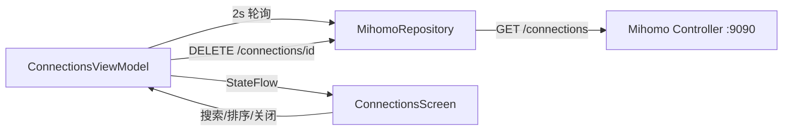

# Veer 第 1 轮功能实施计划

---

## 功能一：活跃连接详情页

### 现有基础

数据层已完全就绪，无需修改 Go 核心或 IPC 协议：

- **REST API**：Mihomo 控制器 `GET /connections` 返回完整连接列表 JSON，`DELETE /connections/{id}` 关闭单个连接
- **Kotlin 数据模型**：`MihomoRepository` 已定义 `ConnectionInfo` 数据类：
  ```kotlin
  data class ConnectionInfo(
      val id: String,
      val host: String,
      val destinationIP: String,
      val network: String,        // "tcp" / "udp"
      val type: String,           // 代理类型
      val chains: List<String>,   // 代理链路
      val rule: String,           // 命中规则
      val rulePayload: String,    // 规则载荷
      val downloadBytes: Long,
      val uploadBytes: Long,
      val start: String           // ISO 时间戳
  )
  ```
- **已有方法**：`MihomoRepository.getConnections(): List<ConnectionInfo>` 和 `MihomoRepository.closeConnection(id: String)`

### 涉及文件

| 操作 | 文件 | 说明 |
|:--|:--|:--|
| [NEW] | `ui/connections/ConnectionsActivity.kt` | Activity 宿主 + Compose 布局 |
| [NEW] | `ui/connections/ConnectionsViewModel.kt` | 数据获取、搜索、排序、关闭连接逻辑 |
| [MODIFY] | `MainActivity.kt` | 在快捷入口网格中增加"连接"按钮跳转 |
| [MODIFY] | `AndroidManifest.xml` | 注册 `ConnectionsActivity` |

### 数据流架构



### 具体变更

#### [NEW] `ConnectionsViewModel.kt`

```kotlin
class ConnectionsViewModel : ViewModel() {
    // 状态
    val connections: StateFlow<List<ConnectionInfo>>   // 当前连接列表
    val searchQuery: StateFlow<String>                 // 搜索关键字
    val sortMode: StateFlow<SortMode>                  // 排序方式
    val filteredConnections: StateFlow<List<ConnectionInfo>> // 筛选+排序后的列表
    
    enum class SortMode { TRAFFIC_DESC, DURATION_DESC, HOST_ASC }
    
    // 操作
    fun refresh()                    // 手动刷新
    fun updateSearch(query: String)  // 搜索筛选
    fun updateSort(mode: SortMode)  // 切换排序
    fun closeConnection(id: String) // 关闭单个连接
    fun closeAll()                  // 关闭全部连接
}
```

- 使用 `repeatOnLifecycle(RESUMED)` 每 2 秒自动刷新
- `filteredConnections` 基于 `searchQuery` 对 host、rule、chains 做模糊匹配
- 排序支持按流量降序、持续时长降序、域名字母序

#### [NEW] `ConnectionsActivity.kt` — UI 组件

```kotlin
@Composable
fun ConnectionsScreen(...)
    // TopAppBar: 标题 + 搜索按钮 + 排序按钮 + 全部关闭按钮
    // SearchBar: AnimatedVisibility 可收起的搜索栏
    // LazyColumn: ConnectionRow 列表
    //   每行: 域名 / 代理链路 / 命中规则 / 协议 / 流量 / 持续时间 / 关闭按钮

@Composable
fun ConnectionRow(info: ConnectionInfo, onClose: () -> Unit)
    // 第一行: 域名/IP (粗体) + 协议徽章 (TCP/UDP)
    // 第二行: 规则名 + 代理节点
    // 第三行: ↑上传流量 ↓下载流量 + 持续时间
    // 右侧: 关闭按钮 IconButton
```

#### [MODIFY] `MainActivity.kt`

在快捷入口网格中增加一个"连接"按钮：
```kotlin
// 在现有的 ProfileActivity、RulesActivity、NodesActivity 等入口旁增加
QuickAction("连接") { startActivity(Intent(this, ConnectionsActivity::class.java)) }
```

### 验证计划

1. `testDebugUnitTest`：新增 ViewModel 单元测试（搜索过滤、排序、关闭后列表更新）
2. `assembleDebug` + `lintDebug`：编译和 Lint 通过
3. 模拟器端到端：VPN 运行时打开连接页，验证数据与 Mihomo `/connections` 一致；搜索过滤有效；关闭连接后 Mihomo 确认移除

### 工作量估算：2-3 天

---

## 功能二：首页实时流量图表

### 现有基础

- `ConnectionStatusRepository.lightweightSnapshot()` 每 1 秒通过 IPC 获取 `TrafficStats`（`uploadTotal`、`downloadTotal`、`activeConnections`）
- 已有差值计算逻辑（`uploadSpeed` / `downloadSpeed` 基于相邻两次 total 的差值）
- `ConnectionOverviewCard` 已展示文本速率，但无图表

### 涉及文件

| 操作 | 文件 | 说明 |
|:--|:--|:--|
| [MODIFY] | `data/ConnectionStatusRepository.kt` | 增加 `SpeedSample` 数据类和 60 秒环形缓冲 |
| [NEW] | `ui/chart/SpeedChartCanvas.kt` | Compose Canvas 实时速率折线图组件 |
| [MODIFY] | `MainActivity.kt` | 在 `ConnectionOverviewCard` 下方集成图表 |

### 数据流架构


### 具体变更

#### [MODIFY] `ConnectionStatusRepository.kt`

```kotlin
data class SpeedSample(
    val timestamp: Long,      // SystemClock.elapsedRealtime()
    val uploadSpeed: Long,    // bytes/sec
    val downloadSpeed: Long   // bytes/sec
)

// 新增字段
private val _speedHistory = MutableStateFlow<List<SpeedSample>>(emptyList())
val speedHistory: StateFlow<List<SpeedSample>> = _speedHistory.asStateFlow()

private val speedBuffer = ArrayDeque<SpeedSample>(61)

// 在现有的 lightweightSnapshot 轮询回调中，计算速率差值后追加到缓冲：
fun onTrafficUpdate(current: TrafficStats, previous: TrafficStats, deltaMs: Long) {
    val sample = SpeedSample(
        timestamp = SystemClock.elapsedRealtime(),
        uploadSpeed = ((current.uploadTotal - previous.uploadTotal) * 1000) / deltaMs,
        downloadSpeed = ((current.downloadTotal - previous.downloadTotal) * 1000) / deltaMs
    )
    speedBuffer.addLast(sample)
    if (speedBuffer.size > 60) speedBuffer.removeFirst()
    _speedHistory.value = speedBuffer.toList()
}
```

#### [NEW] `ui/chart/SpeedChartCanvas.kt`

```kotlin
@Composable
fun SpeedChart(
    history: List<SpeedSample>,
    modifier: Modifier = Modifier
)
```

- 使用 `Canvas` 绘制 60 个数据点的双线折线图
- 上传线用 Material `primary` 色，下载线用 `tertiary` 色
- Y 轴自动缩放（取最近 60 秒的最大速率）
- 底部标注 "60s" / "30s" / "现在" 时间刻度
- 右上角显示当前实时速率文本
- 高度固定 120.dp，宽度填满容器
- VPN 未连接时显示空状态（平线 + "未连接"）

#### [MODIFY] `MainActivity.kt`

在 `ConnectionOverviewCard` 组件之后插入：
```kotlin
val speedHistory by connectionStatusRepo.speedHistory.collectAsStateWithLifecycle()

SpeedChart(
    history = speedHistory,
    modifier = Modifier
        .fillMaxWidth()
        .padding(horizontal = 16.dp)
)
```

### 验证计划

1. 单元测试：`SpeedSample` 环形缓冲正确性（满 60 后淘汰、空状态、边界）
2. 模拟器验证：VPN 运行时观察图表实时更新；断开 VPN 后图表停止并显示空状态
3. 性能验证：Canvas 重绘不造成明显帧率下降（目标 <2ms/帧）

### 工作量估算：2 天

---

## 功能三：节点页面体验优化

### 现有基础

- `NodesViewModel` 已从 `MihomoRepository.getRoutingSnapshot()` 获取完整的 `RoutingSnapshot`
- `RoutingSnapshot` 包含 `List<ProxyGroup>`，每个 `ProxyGroup` 包含 `List<ProxyNode>`
- `ProxyNode` 已有字段：`name`、`type`、`alive`、`delayMs`（Int, 0=未测速, 65535=超时）、`regionCode`
- `NodesActivity` 的 `NodeRow` 已展示延迟数字，但无颜色区分
- 排序和筛选完全未实现

### 涉及文件

| 操作 | 文件 | 说明 |
|:--|:--|:--|
| [MODIFY] | `ui/nodes/NodesViewModel.kt` | 增加排序策略、地区筛选、筛选状态 |
| [MODIFY] | `ui/nodes/NodesActivity.kt` | UI 增加排序/筛选控件、延迟颜色指示器 |

### 具体变更

#### [MODIFY] `NodesViewModel.kt`

```kotlin
// 新增排序模式
enum class NodeSortMode { DEFAULT, DELAY_ASC, NAME_ASC, REGION }

// 新增筛选状态
data class NodeFilter(
    val sortMode: NodeSortMode = NodeSortMode.DEFAULT,
    val regionFilter: String? = null,      // null = 全部地区
    val hideUnavailable: Boolean = false    // 隐藏不可用节点
)

private val _filter = MutableStateFlow(NodeFilter())
val filter: StateFlow<NodeFilter> = _filter.asStateFlow()

// 从当前节点列表提取所有可用地区标签
val availableRegions: StateFlow<List<String>>  // ["HK","US","JP","SG",...]

// 筛选+排序后的组列表
val filteredGroups: StateFlow<List<ProxyGroupUi>>

fun updateSortMode(mode: NodeSortMode)
fun updateRegionFilter(region: String?)
fun toggleHideUnavailable()
```

排序逻辑：
- `DELAY_ASC`：可用节点按 delayMs 升序，不可用节点排最后
- `NAME_ASC`：按节点名称字母排序
- `REGION`：先按 regionCode 分组，组内按延迟排序
- `DEFAULT`：保持原始订阅顺序

筛选逻辑：
- `regionFilter != null`：只展示匹配地区的节点
- `hideUnavailable = true`：隐藏 `alive == false` 或 `delayMs == 65535` 的节点

#### [MODIFY] `NodesActivity.kt`

**顶部增加筛选栏**：
```kotlin
// TopAppBar 下方增加一行 FilterRow
@Composable
fun FilterRow(
    filter: NodeFilter,
    regions: List<String>,
    onSortChange: (NodeSortMode) -> Unit,
    onRegionChange: (String?) -> Unit,
    onHideUnavailableToggle: () -> Unit
)
```
- 排序：`FilterChip` 下拉选择（默认 / 延迟↑ / 名称 / 地区）
- 地区：水平滚动的 `FilterChip` 列表（全部 / HK / US / JP / ...），选中高亮
- 隐藏不可用：`FilterChip` 开关

**NodeRow 延迟颜色改造**：

修改现有的延迟文本展示逻辑：
```kotlin
@Composable
fun DelayBadge(delayMs: Int) {
    val (color, text) = when {
        delayMs == 0 -> MaterialTheme.colorScheme.outline to "未测速"
        delayMs >= 65535 -> Color(0xFFEF4444) to "超时"   // 红色
        delayMs <= 100 -> Color(0xFF22C55E) to "${delayMs}ms"  // 绿色
        delayMs <= 300 -> Color(0xFFEAB308) to "${delayMs}ms"  // 黄色
        else -> Color(0xFFEF4444) to "${delayMs}ms"            // 红色
    }
    
    Surface(
        color = color.copy(alpha = 0.15f),
        shape = RoundedCornerShape(4.dp)
    ) {
        Text(
            text = text,
            color = color,
            style = MaterialTheme.typography.labelSmall,
            modifier = Modifier.padding(horizontal = 6.dp, vertical = 2.dp)
        )
    }
}
```

### 验证计划

1. 单元测试：排序函数正确性（各排序模式 + 边界条件）、地区筛选过滤
2. `lintDebug` + `assembleDebug` 通过
3. 模拟器端到端：切换排序模式后节点顺序变化；选择地区筛选后只展示对应节点；延迟颜色与数值对应

### 工作量估算：1.5-2 天

---

## 整体验证门禁

三个功能全部完成后，执行完整的回归验证：

```bash
# 自动化门禁
./gradlew testDebugUnitTest lintDebug assembleDebug

# 一次性模拟器可用 connectedDebugAndroidTest；共享真机必须保留应用数据
ANDROID_SERIAL=<serial> tools/run_device_tests_preserving_app.sh

# Release 构建验证
./gradlew assembleRelease
```

端到端验证清单：
- [ ] VPN 运行中打开连接页，数据与 `/connections` 一致
- [ ] 搜索过滤连接有效，关闭连接后列表更新
- [x] 首页流量图表实时更新，VPN 断开后停止
- [x] 节点按延迟排序后最快节点在最上方
- [x] 地区筛选只展示对应地区节点
- [x] 延迟颜色与阈值对应（绿/黄/红/灰）
- [ ] 现有功能无回归（AI 规则、Profile 切换、Per-App、DNS 设置等）

---

## 总工作量与时间线

| 功能 | 预估 | 核心工作 |
|:--|:--|:--|
| 活跃连接详情页 | 2-3 天 | 新建 2 文件 + 修改 2 文件 |
| 首页流量图表 | 2 天 | 新建 1 文件 + 修改 2 文件 |
| 节点体验优化 | 1.5-2 天 | 修改 2 文件 |
| 回归验证 | 0.5 天 | 全量测试 |
| **合计** | **~7 天** | **新建 3 文件，修改 6 文件** |

---

## 执行记录：2026-07-31

### 功能一：活跃连接详情页——已完成

在原有页面雏形上完成了以下加固：

- `MihomoRepository.getConnectionDetails()` 使用 `Result` 区分“连接列表为空”和“控制器请求失败”。
- `closeConnection()` 拒绝空 ID，并通过 OkHttp path segment 编码连接 ID，避免特殊字符破坏请求路径。
- `ConnectionsViewModel` 通过可注入 `ConnectionsGateway` 隔离数据访问，支持稳定的单元测试。
- 两秒轮询由 `ConnectionsActivity` 的 `repeatOnLifecycle(RESUMED)` 驱动；页面退到后台后自动停止。
- 搜索覆盖 host、目标 IP、规则、规则载荷和代理链；三种排序对大小写、无效开始时间及流量溢出做了边界处理。
- 成功关闭连接后立即从本地列表移除，不等待下一次轮询；请求失败保留现有列表并展示错误信息。

验证结果：

- 活跃连接定向单元测试：4/4 通过。
- 全量 `testDebugUnitTest`：135/135 通过。
- `lintDebug`：通过。
- `assembleDebug`：通过。
- 真机 M2102J2SC（Android 13）：Debug APK 覆盖安装成功；VPN、Mihomo 控制器、互联网探测正常。
- 真机交互：主页入口、实时连接列表、搜索空结果、排序菜单、后台/前台恢复均通过，无应用崩溃。
- 模拟器专项验证未执行，保持为后续门禁项。

### 功能二：首页实时流量图表——已完成

实现与加固内容：

- `SpeedHistoryBuffer` 同时限制最近 60 个样本和最近 60 秒，避免退到后台后把旧样本冒充实时数据。
- 速率计算不再依赖上传累计值大于零，纯下载会话能够正常生成样本。
- 超过 5 秒的采样间隔不计入当前速率；计数器回退视为新会话并清空旧历史。
- 页面恢复前台时重建采样基线，VPN 断开时同步清空基线和图表历史。
- 图表增加“未连接”“等待流量样本”状态、60s/30s/现在刻度、当前上下行文本及无障碍描述。
- 将实时历史收集和仪表盘轮询下沉到独立 Compose 子树，避免每秒重组整个首页。

验证结果：

- 新增采样、缓冲和格式化测试 6 个；全量 `testDebugUnitTest` 141/141 通过。
- `lintDebug` 与 `assembleDebug` 通过。
- 真机 M2102J2SC（Android 13）通过 20 MB 实际下载验证，曲线正确记录峰值。
- 断开后空状态和历史清理通过，重连后不会恢复旧会话数据；验证结束时 VPN 已恢复运行。
- 120Hz 真机稳定采样阶段无 missed-vsync、无 `Skipped frames`。整页 Debug 更新帧 CPU 中位数约 23ms、GPU 中位数约 6ms；Canvas 单独 `<2ms` 仍需专用 Macrobenchmark 才能独立判定。

### 功能三：节点体验优化——已完成

实现与加固内容：

- 将筛选排序抽取为纯函数，默认模式保留订阅顺序，延迟/名称/地区模式提供确定性顺序。
- 地区筛选忽略代码大小写，并移除筛选后没有节点的空策略组。
- 延迟排序明确区分已测速、未测速、不可用三个层级；不可用节点始终置底。
- “隐藏不可用”同时识别 `alive == false` 和 `delayMs >= 65535`，选择按钮也禁止选中这类节点。
- 提取独立 `FilterRow`，为排序、地区和隐藏不可用控件增加稳定测试标签。
- 延迟徽章改用纯展示模型，覆盖未测速、绿色、黄色、红色和超时状态。

验证结果：

- 新增节点筛选/排序/展示测试 8 个；全量 `testDebugUnitTest` 149/149 通过。
- `lintDebug` 与 `assembleDebug` 通过。
- 真机延迟升序显示 97、98、99、105、106ms；JP 筛选后可见节点全部为 `[JP]`。
- 一键测速完成 69 个真实节点：41 个可用、28 个超时或失败，进度和完成摘要正确。
- 隐藏不可用开关语义状态正确；验证后恢复为“默认 / 全部 / 显示所有”。
- 测试过程未切换节点，VPN 保持运行，未出现应用崩溃。

### AI 核心可靠性与本地优先执行——已完成

实现与加固内容：

- 新增非变更型 `clarify` 动作。模型遇到缺少目标、地区或具体动作的含糊指令时，
  必须要求澄清，不能为了生成计划而猜测规则或节点。
- 未实现的 `dns_change` 不再返回假成功；执行器会在预验证阶段拒绝，并引导用户
  前往“自定义 DNS”页面。
- 执行反馈不再信任模型的计划摘要，而是完全根据规范化、可用节点替换和实际提交后的
  `StepResult` 生成；每条规则都明确显示真实流量出口方向。
- 本地解析器支持多个服务共享一个地区、多个子句分别路由到不同地区、知名服务
  DIRECT/REJECT，以及 `Netflix go HK` 等中英文高频表达。
- 节点健康状态为未知但未被明确判坏时可参与本地选择；`alive=false` 或
  `delay=65535` 仍会被拒绝。地区诊断请求优先进入诊断，不再被地区可用性预检误伤。
- 澄清、诊断和纯策略组切换不再初始化或读取 AI 规则文件。
- 前端允许无 API Key 时提交本地确定性指令；只有本地无法解析的复杂指令才提示配置
  DeepSeek Key，且 Key 不写入代码、测试或日志。

验证结果：

- AI 专项单元测试 27/27 通过，覆盖多地区多服务、英文短指令、服务/域名混合目标、
  服务名域名消歧、服务直连、未知健康状态、
  clarify 解码/执行、DNS 拒绝、计划混用拒绝和实际出口反馈。
- 全量 Debug 单元测试更新为 161/161；`lintDebug` 与 `assembleDebug` 通过。
- 真机 M2102J2SC（Android 13）在未配置 API Key 时成功本地执行
  `Netflix → 日本东京02`、`YouTube → 美国08`，Mihomo `/rules` 与界面反馈一致。
- 香港唯一节点真实不可用时，`Netflix go HK` 被预验证拒绝，没有静默回落到机场默认出口。
- `ip.skk.moe` 规则先指向日本节点时真实 HTTPS 响应边缘为 `NRT`，原位改为美国节点后
  响应边缘变为 `LAX`；规则表、连接链和界面出口方向一致。
- 三条临时规则均已通过应用界面删除并热同步；最终 VPN 运行中、控制器可用、
  实际互联网可用，首页恢复为 0 条 AI 规则。

### ChatGPT 美国出口不可访问修复——已完成

根因与修复：

- `ChatGPT go us` 的规则本身已正确指向美国节点，但已有长连接不会因规则热重载自动
  迁移。AI 规则提交后现在只关闭与目标服务/域名匹配的旧连接；重复执行同一条指令也会
  执行定向刷新，不影响其他应用连接。
- 真机进一步定位到 ChatGPT App 的 TLS 主机名校验失败。订阅使用明文 UDP DNS 作为
  主解析器，污染结果又逃过 GeoIP fallback；`chatgpt.com`、`api.openai.com` 一度被解析
  到 Facebook/Twitter 等无关网段。
- 继承订阅 DNS 时，如果主要解析器全部为明文，运行时生成器会改用 Cloudflare 加密 DoH，
  并移除可能重新选择受污染结果的 provider fallback/filter。用户主动保存的自定义 DNS
  仍保持完全可控。
- “自定义 DNS”推荐值更新为 `1.1.1.1` 与 Cloudflare DoH，不再默认附加会返回审查结果的
  地域 fallback。

验证结果：

- 定向旧连接验证：创建 `chatgpt.com` 活跃连接后重复执行 `ChatGPT go us`，仅该连接被
  关闭，界面明确提示“已刷新 1 个旧连接”。
- DNS 缓存清空后的真机结果恢复为 Cloudflare 地址：`chatgpt.com`、`api.openai.com`、
  `android.chat.openai.com`、`cdn.oaistatic.com` 和 `www.gstatic.com` 均无污染地址。
- 强制结束并重新启动 ChatGPT App 后，聊天输入页、Projects/Pinned/Recents 会话列表均能
  联网加载；logcat 无 `net_error -100`、证书或 TLS 握手错误。
- 全量 `testDebugUnitTest` 166/166、`lintDebug`、`assembleDebug` 全部通过。
- 保留用户现有 Netflix→日本与 OpenAI→美国两条规则；VPN、控制器和实际网络均恢复运行。

### 真机回归基础设施加固——已完成

发现与修复：

- `StartupProgressUiInstrumentedTest` 在无法为测试 Activity 获取焦点的 Xiaomi/HyperOS
  设备上没有前置跳过规则，导致 18/19 后无限等待。新增统一
  `InteractiveComposeDeviceRule`，四个 Compose UI 测试共享相同前置判断；启动进度用例
  另加 10 秒 JUnit 超时，防止设备异常再次卡死整套测试。
- Android Gradle Plugin 的 `connectedDebugAndroidTest` 会在任务结束后卸载被测包，不适合
  保存有开发者配置和凭据的共享真机。新增 `tools/run_device_tests_preserving_app.sh`：使用
  `adb install -r` 覆盖目标 APK、手动执行 instrumentation，结束后只卸载测试包。

验证结果：

- 新脚本在 M2102J2SC Android 13 上完成 19 个测试条目；14 个生命周期/故障注入用例和
  Application Context 全部通过，4 个需要 Compose host window 的 UI 用例按设备策略立即
  跳过，整套 43.983 秒正常结束。
- 测试后目标包、订阅、profile-scoped DNS 与 AI 规则文件均保留；测试包已清理。
- 恢复当前运行态后，Netflix→日本东京02、OpenAI→美国04 两条规则实时生效；
  ChatGPT DNS 返回 Cloudflare 地址，OpenAI HTTPS 返回预期未认证响应。

### ChatGPT 自建解析绕过域名规则修复——已完成

根因与修复：

- 真机连接表显示 ChatGPT App 直接连接真实 IP，`host/sniffHost` 为空，因此置顶的
  `GEOSITE,openai` 没有机会命中，最终落入订阅 `MATCH → 漏网之鱼 → 新加坡`。
- 运行配置现在默认启用 HTTP Host、TLS SNI 与 QUIC SNI 嗅探，并允许用恢复出的域名
  覆盖规则匹配目标。配置生成器负责新订阅；`ConfigManager` 运行时物化负责自动补强
  旧版本已经保存的订阅，无需用户重新导入。
- 嗅探只读取协议中用于路由的明文 hostname/SNI，不进行 TLS 解密。

验证结果：

- 修复前设备访问 OpenAI API 在 TLS 阶段超时；修复后返回 HTTP 401，完整连接约 1.1 秒。
- 冷启动 ChatGPT 后，`android.chat.openai.com`、`ws.chatgpt.com`、`ab.chatgpt.com`
  全部显示 `sniffHost`，命中 `GeoSite/openai`，且连接链仅包含美国04节点。
- 全量 Debug 单元测试更新为 167/167；Lint、Debug APK、AndroidTest APK 均通过。
- 保数据真机回归完成 19 个测试条目（14 个生命周期/故障注入实际通过，4 个 Xiaomi
  Compose host 用例按策略跳过）；结束后恢复 VPN，profile 与 AI 规则文件保持完整。

### 第 2 轮：AI 操作历史与快捷模板——已完成

实现内容：

- `AiHistoryStore` 在应用私有目录中保存最多 100 条 profile-scoped JSON 记录，包括
  原始 prompt、解析来源、执行结果、实际生成规则及可撤销快照；API Key 不进入记录。
- 历史重新执行调用当前 `AiController.handle()`，重新解析和选择当前健康节点。
- 撤销同时覆盖 AI 规则存储和 Selector 选择，并在执行前比较 after 快照；检测到后续
  修改时拒绝撤销。提交中途失败会将已经恢复的部分补偿回撤销前状态。
- 撤销完成后按规则 matcher 和策略组 chain 定向关闭旧连接，避免会话继续使用旧出口。
- 输入为空时展示四个快捷模板，点击仅填充；历史默认显示三条，可展开十条，并提供
  明确的来源、成功/失败、生成规则、再次执行和撤销状态。

验证结果：

- 新增 4 个单元测试，全量更新为 171/171；Lint、Debug、AndroidTest 构建通过。
- R8 Release 在 6 GiB 临时 Gradle heap 下成功，未修改项目默认 heap；产物仍为未签名
  Universal APK，发布前必须使用受保护的正式签名配置。
- HyperOS 真机把 `example.com` 从 DIRECT 改为 REJECT 后，旧 DIRECT 历史因状态冲突被
  正确拒绝；撤销 REJECT 恢复 DIRECT，再撤销 DIRECT 完全移除测试规则。
- 保数据真机测试 19 项通过/按策略跳过；测试历史与规则已清理，Netflix→日本、
  OpenAI→美国保持不变，最终 Engine=Running、VPN Connected、OpenAI HTTPS=401。
- Android 16.1 arm64 AVD 使用 ABI split Debug APK 完成 Round 1 遗留端到端验收：最小
  测试 profile 的 VPN、Controller 和互联网正常，连接详情包含真实 host/规则/流量，
  首页 60 秒图表产生折线，节点筛选选中状态及新 AI 模板/历史布局均通过可视检查。

### 第 2 轮：独立设置页与三档主题——已完成

实现内容：

- 新建 `SettingsActivity`，统一承载 AI Key、DNS、应用分流、后台运行保护、外观和关于信息；
  页面只写设置并跳转到已有功能页，不直接控制 VPN 或 JNI。
- 主页移除 API Key 编辑器、DNS、Per-App 和后台保护卡片，快捷入口固定为配置、AI 规则、
  节点、连接、实时日志、设置。
- API Key 继续使用 Android Keystore AES-GCM 加密，设置页不回显旧 Key；主页在恢复时刷新
  Key 存在状态。
- 新增 SYSTEM/LIGHT/DARK 三档主题偏好和进程级 `StateFlow`，切换在当前页面立即生效并
  持久化到后续 Activity。
- 设置摘要明确当前 profile、应用分流方向/数量及后台限制状态。

验证结果：

- 单元测试 175/175，`lintDebug`、`assembleDebug`、`assembleDebugAndroidTest`、R8
  `assembleRelease` 均通过。
- Android 16.1 arm64 模拟器设置专项用例与完整 20 项 instrumentation 通过；主页入口、
  六个设置分区、主题跨 Activity 持久化和 Key 密文存储/清除均经实际 UI 验证。
- HyperOS 真机保数据升级并恢复 Running，内建网络诊断八项 PASS；仅移除本轮生成的诊断
  历史，原 profile 和既有 AI 历史保留。

下一项：字符串资源提取与中英文 i18n 基础；完成构建和页面回归后，再进入单 Activity
Compose Navigation 迁移。
